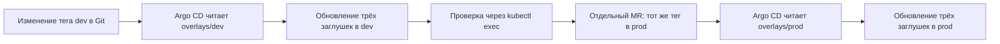

# ДЗ6: pull-модель на приложениях из ДЗ5

Используем прежние имена сервисов: `catalog`, `orders`, `notifications`.
В ДЗ5 это были каталог товаров, оформление заказов и обработка уведомлений.
Здесь каждый сервис — простая заглушка на nginx: по `/` возвращает пустой
`index.html` с HTTP 200. Через `/ready` Kubernetes проверяет готовность nginx.
Бизнес-логика и подключения к PostgreSQL, Kafka, Redis для этой части не нужны.

У каждого сервиса свой Deployment и Service на порту 8080. В одном кластере
два отдельных namespace: `hw6-orders-dev` и `hw6-orders-prod`.
Исходная домашка в `k8s-hw5` сохранена без изменений.

## Что добавлено

```text
k8s-hw6/
├── base/
│   ├── apps/
│   │   ├── catalog.yaml           # Service + Deployment
│   │   ├── orders.yaml
│   │   └── notifications.yaml
│   ├── nginx/
│   │   ├── default.conf           # HTTP на 8080, /ready
│   │   └── index.html             # Пустой файл
│   └── kustomization.yaml         # Общие ресурсы и ConfigMap с файлами
├── overlays/
│   ├── dev/
│   │   ├── namespace.yaml
│   │   └── kustomization.yaml     # Версия образа для dev
│   └── prod/
│       ├── namespace.yaml
│       └── kustomization.yaml     # Версия образа для prod
└── argocd/
    ├── dev-application.yaml       # Argo CD следит за overlays/dev
    └── prod-application.yaml      # Argo CD следит за overlays/prod
```

`base` — общая конфигурация трёх сервисов. Overlay добавляет namespace
и задаёт тег nginx через `images[].newTag`. Сейчас в обоих окружениях
стоит `1.28.0-alpine`. Одна запись версии применяется к трём заглушкам.

Kustomize упаковывает `default.conf` и пустой `index.html` в ConfigMap,
который монтируется в каждый контейнер. В имя ConfigMap включается хеш:
изменение файлов меняет ссылку в Deployment и вызывает обновление Pod.

## Как работает pull



В каждом `Application`:

- `repoURL` — адрес Git-репозитория с этой папкой;
- `targetRevision: main` — отслеживаемая ветка;
- `path` — путь к overlay своего окружения от корня Git-репозитория;
- `destination` — текущий кластер Argo CD и namespace окружения;
- `automated` — автоматическое применение изменений;
- `selfHeal: true` — возврат управляемых ресурсов к состоянию из Git после ручных изменений;
- `prune: true` — удаление управляемых ресурсов, убранных из Git. Здесь нет PVC и баз данных.

Argo CD периодически проверяет репозиторий, собирает манифесты Kustomize
и сравнивает их с ресурсами Kubernetes. При изменении желаемого состояния
он сам применяет обновление. Webhook можно добавить для ускорения проверки,
но для этого примера достаточно периодического опроса.

Два `Application` независимы: Argo CD сам не ждёт успешного теста dev перед prod.
Проверка и отдельное согласование изменения prod — часть выбранного процесса.

## Как перенести новую версию из dev в prod

Для учебных заглушек берём готовый образ nginx. Например, при переходе
с `1.28.0-alpine` на доступный в registry тег `1.28.1-alpine`:

1. Разработчик меняет только `overlays/dev/kustomization.yaml`:
   `newTag: "1.28.1-alpine"`, затем отправляет изменение в Git и вливает в `main`.
2. Argo CD обновляет dev. Prod остаётся на `1.28.0-alpine`.
3. Разработчик ждёт завершения rollout и проверяет HTTP-ответы командами ниже.
4. В отдельном merge request меняет тег prod на **тот же проверенный тег**.
   В описание MR записывает версию, Git-коммит dev и результат проверки.
5. После review и слияния Argo CD обновляет prod.

Продвижение — это изменение записи версии, а не повторная сборка образа.
Нельзя переносить «что сейчас самое новое»: переносится версия из успешной
проверки. Процесс предполагает запрет перезаписи release-тегов; для строгой
фиксации содержимого можно использовать digest.

Если по условию образ собрал CI, процесс тот же: после публикации CI сообщает
точный тег, разработчик записывает его в dev-манифест и проходит шаги 2–5.
Для собственного образа меняются также имя registry/репозитория образа.
CI-бот и Image Updater для этого минимального процесса не требуются.

## Подготовка Argo CD

Предполагается, что Kubernetes и Argo CD уже установлены, Argo CD работает
в namespace `argocd`, а проект `default` разрешает этот репозиторий и окружения.

1. Разместить файлы в Git. В обоих `Application` заменить
   `https://git.example.invalid/student/education.git` на настоящий URL.
2. Пути `k8s-hw6/overlays/dev` и `k8s-hw6/overlays/prod` рассчитаны на то,
   что корень Git-репозитория содержит папку `k8s-hw6`. Если содержимое этой
   папки стало корнем отдельного репозитория, убрать префикс `k8s-hw6/`.
3. Для приватного репозитория заранее настроить доступ Argo CD к нему.
4. Один раз зарегистрировать два `Application` следующей командой.

Команды из корня `education`, после выбора нужного kubectl context:

```bash
kubectl apply -f k8s-hw6/argocd/
kubectl -n argocd get applications
```

Этот разовый `apply` регистрирует контролируемые приложения. Дальнейшие
релизы идут через Git: манифесты сервисов применяет Argo CD.

## Проверка через kubectl

Когда Argo CD уже создал Deployment в dev:

```bash
for app in catalog orders notifications; do
  kubectl -n hw6-orders-dev rollout status deployment/$app --timeout=120s
done

# Проверяем все три Service из контейнера catalog.
# wget выводит HTTP-заголовки, wc показывает размер пустого ответа: 0 байт.
kubectl -n hw6-orders-dev exec deployment/catalog -- sh -ec '
  for app in catalog orders notifications; do
    echo "$app"
    wget -S -O /tmp/response "http://$app:8080/"
    wc -c < /tmp/response
  done
'

# Какой образ указан в Deployment?
kubectl -n hw6-orders-dev get deployments \
  -o 'custom-columns=NAME:.metadata.name,IMAGE:.spec.template.spec.containers[*].image'

# Какие образы реально запущены? imageID содержит идентификатор образа.
kubectl -n hw6-orders-dev get pods \
  -o 'custom-columns=NAME:.metadata.name,IMAGE:.spec.containers[*].image,IMAGE_ID:.status.containerStatuses[*].imageID'
```

Для prod использовать те же команды с namespace `hw6-orders-prod`.
Проверка подтверждает доступность заглушек; поведения магазина здесь нет.

Для проверки синтаксиса и сборки без подключения к кластеру:

```bash
kubectl kustomize k8s-hw6/overlays/dev
kubectl kustomize k8s-hw6/overlays/prod
```

Локально проверена сборка обоих overlay и согласованность Service,
Deployment, ConfigMap, namespace и путей Argo CD. Запуск nginx и синхронизация
Argo CD в живом кластере не проверялись. URL Git остаётся явной заглушкой.

Описание параметров: [Argo CD Application](https://argo-cd.readthedocs.io/en/stable/user-guide/application-specification/),
[автоматическая синхронизация](https://argo-cd.readthedocs.io/en/stable/user-guide/auto_sync/),
[Kustomize](https://kubernetes.io/docs/tasks/manage-kubernetes-objects/kustomization/).
